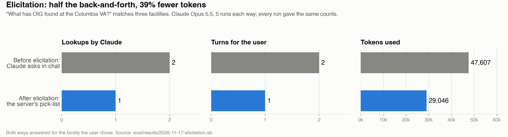
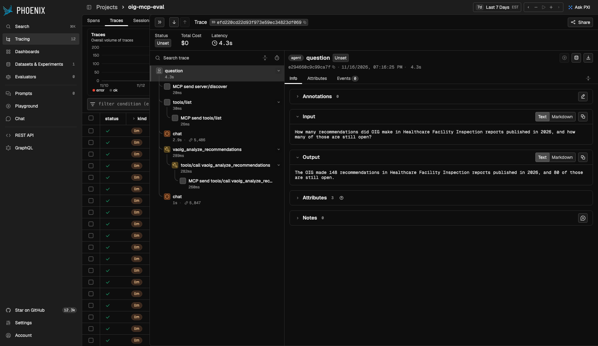
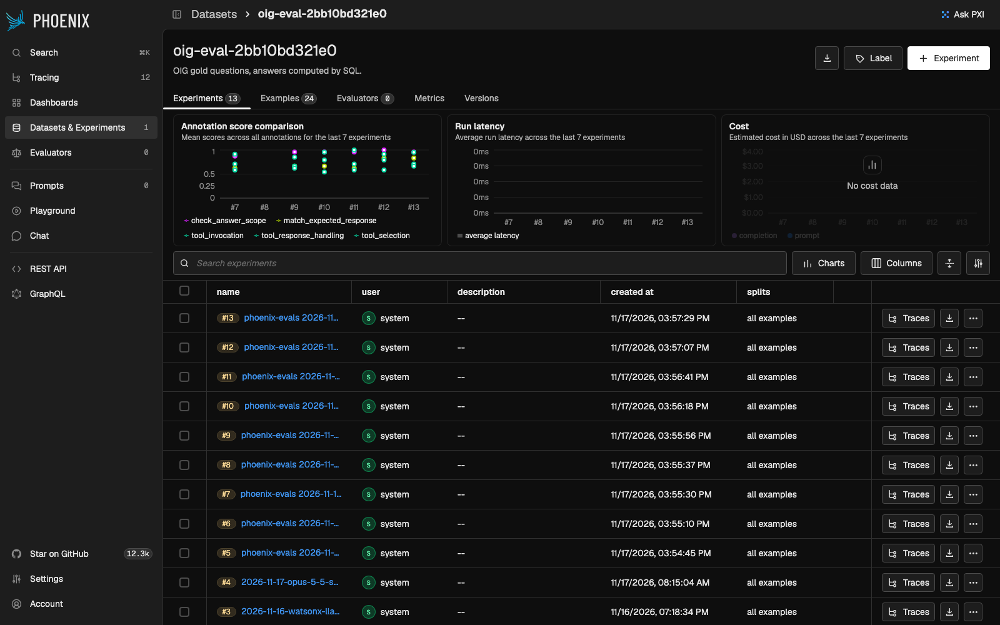
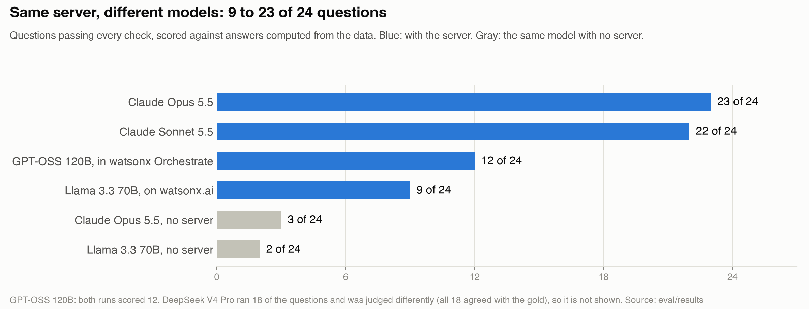
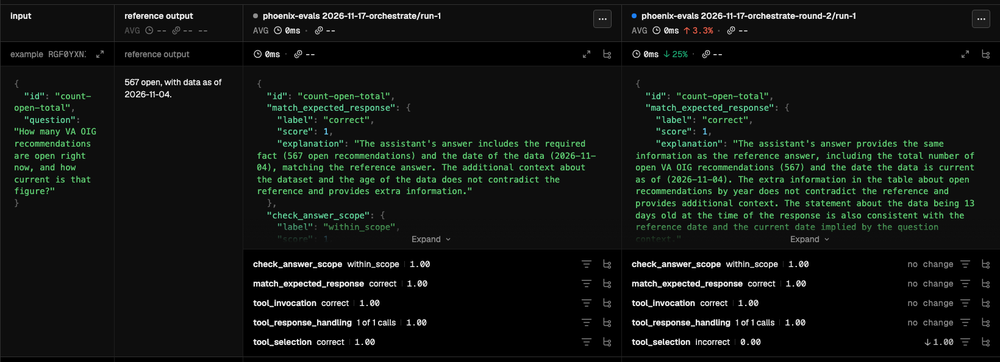

# Deck source: oig-mcp

*Source text for the hackathon presentation deck. Each slide has a title, the body for the slide, a suggested visual, and speaker notes. Slides follow the order of the hackathon's sample deck, with five added: who the server serves (slide 4), asking the user instead of guessing (slide 9), the watsonx Orchestrate deployment (slide 10), the same server across five models (slide 14), and the failure analysis (slide 15). Figures come from [the evaluation document](evaluation-document.md) and [SECURITY.md](../../SECURITY.md) as of November 17, 2026, including the second Orchestrate round.*

---

## Slide 1: Title

**Title:** VA OIG Oversight Assistant

**Subtitle:** An MCP server that lets any AI agent answer questions across VA Inspector General reports, with a citation for every finding

**Footer:**
- GSA MCP Server and AI Agent Government Hackathon, Dataset Access track
- Team: Troy Sybert, MD, MPH, and Mikhail Kuprian, MD
- Hosted over HTTPS behind Cloudflare, and deployed in IBM watsonx Orchestrate
- github.com/HacksterT/oig-mcp

**Visual:** None, or the project mark.

**Speaker notes:** The server is the entry. The agents in this deck are the instruments we used to test it.

---

## Slide 2: The challenge

**Title:** The Challenge: A Public Record Built for Reading, Not for Questions

**Body:**

VA's Office of Inspector General (OIG) publishes its oversight work at vaoig.gov: 4,410 reports and 15,649 recommendations, with 11,264 facility responses inside the report PDFs. The record is public, but it is hard to use for the questions oversight work actually asks.

1. **No machine access.** There is no API or bulk export, so no AI assistant can work with the record directly.
2. **Answers are inside documents.** What a facility committed to do, and by when, appears only in report PDFs.
3. **Search finds documents, not patterns.** The site answers "which reports mention this?" It cannot answer "what keeps being cited?", "is this growing year over year?", "how long do fixes like this take?", or "what did other facilities do about it?"
4. **The work falls on people.** Staff preparing for an inspection read prior reports by hand to learn what OIG has found before, at their own facility and at its peers.

**Visual:** A vaoig.gov report page beside a PDF page of facility responses, with the cross-report questions overlaid.

**Speaker notes:** OIG's site is good at finding a document when you know what you want. The gap is any question that spans many documents.

---

## Slide 3: The solution

**Title:** The Solution: An MCP Server Over the Whole OIG Record

**Body:**

oig-mcp gives any MCP-compatible agent seven tools over a structured, regularly refreshed copy of what OIG publishes.

- **Ask in plain language,** across every report, and get exact counts, trends, time to close, recurring findings, and peer commitments.
- **Every finding can be checked.** It comes with the OIG report number, a vaoig.gov link, and the date the data was collected.
- **It states its limits.** It declines what the data cannot support: rating facilities, predicting findings, computing a deadline miss rate, or guessing who was responsible.
- **It runs anywhere MCP does.** The same server is hosted over HTTPS behind Cloudflare for any MCP client, and deployed in IBM watsonx Orchestrate over stdio.

Example questions:
- "Which findings recur across VA medical facilities?"
- "How many suicide prevention findings has OIG made each year since 2020?"
- "What did peer facilities commit to doing when cited for unsecured medication carts?"
- "Prepare a brief for the Durham VA Medical Center's next inspection."

**Visual:** A question going into an agent, the server's tools, and an answer with report numbers and links.

**Speaker notes:** All data is public. The server uses no internal VA systems and no nonpublic information, and it is not an official VA or OIG product.

---

## Slide 4: Who it serves

**Title:** Mission: Oversight That Facilities Can Learn From

**Body:**

| User | What the server gives them |
|---|---|
| **Facility patient safety and quality staff,** preparing for an OIG inspection | The facility's open and repeat findings, the most common findings at peer inspections, and what peers committed to do about them |
| **Program offices** | Whether a finding is isolated or systemic before deciding on a national fix, and how long similar recommendations take to close |
| **Oversight and policy staff** | What is open and aging, by office, topic, or report type, reconciled with OIG's own published counts |

The design favors trust over polish. It produces no facility scores or rankings. A repeat finding means the same issue was cited again, not that nothing was done. A next-inspection date is labeled an estimate, because OIG publishes no schedule.

**Visual:** Three user cards, each with one example question and a cited answer.

**Speaker notes:** This is the service delivery and oversight mission. A facility can learn from how its peers responded instead of starting from nothing.

---

## Slide 5: Server design overview

**Title:** Server Design Overview

**Body:**

The project is built in Python on FastMCP. It has two parts, and the MCP server calls exactly one origin.

- **Data service** (companion repository): crawls vaoig.gov, parses report pages and PDFs into SQLite, indexes them for search by keyword and by meaning, and serves a JSON API behind Cloudflare Access with its own API key.
- **oig-mcp** (this repository): 7 tools, 3 resources, and 2 workflow prompts. The data address is set by the operator, never by a tool argument.
  - **Tools:** data status, search, analysis, systemic clusters, one report, a facility profile, an inspection brief.
  - **Resources:** an about page, the facility registry, and filter values.
  - **Prompts:** an inspection readiness checklist and an open-recommendation aging brief.
- **Middleware:** bearer authentication, a per-client rate limit, a usage log, and traces linked to the data service by trace ID.
- **Transports:** stdio (watsonx Orchestrate, desktop clients) and Streamable HTTP (a hosted endpoint at `https://mcp.troymd.com/mcp`, reached through a Cloudflare Tunnel with no open port and a bearer token per client).

**Visual:**

```
vaoig.gov ──> data service: crawler, SQLite, hybrid search, JSON API, behind Cloudflare Access
                     │  HTTPS, service token and API key
                     ▼
              oig-mcp: 7 tools · 3 resources · 2 prompts
              auth · rate limit · usage log · traces
                     │  stdio or Streamable HTTP
                     ▼
  watsonx Orchestrate agent · Claude · any MCP client
```

**Speaker notes:** One tool per file, each registering itself. Everything outbound goes through one hardened HTTP client. Behind the API is a private pipeline built for this entry: it crawls vaoig.gov, extracts 11,264 facility responses from inspection PDFs with rules rather than an LLM, groups recurring findings into 283 clusters, and builds hybrid search: a keyword index plus 26,077 meaning vectors from an embedding model that runs locally, one for every recommendation and corrective action, so a question in the user's own words finds OIG's differently worded findings and no report text leaves the machine. It reconciles every build with OIG's own listing row by row before publishing. The wiki's Data source page describes each stage.

---

## Slide 6: Key decision 1

**Title:** Key Decision 1: Tools Built Around the User's Goal, Not the API's Endpoints

**Body:**

**Decision:** Seven tools, each named for a task a user has. Several combine many data requests, so the agent makes one call instead of orchestrating ten.

| Tool | For |
|---|---|
| `vaoig_get_dataset_status` | How current the data is, and the valid filter values |
| `vaoig_search_findings` | Find findings, and what peer facilities committed to do |
| `vaoig_analyze_recommendations` | Exact counts, trends, time to close, aging |
| `vaoig_find_systemic_clusters` | Findings that recur across reports, and how common each is |
| `vaoig_get_report` | One report in full, with each facility response |
| `vaoig_get_facility_profile` | One facility's reports, findings, and repeat findings |
| `vaoig_get_inspection_brief` | Prepare one facility for inspection from the public record |

**Rationale:**
- **Fewer calls means fewer mistakes.** The inspection brief alone runs up to ten searches. A weaker model fails when it must sequence that work itself.
- **Exact answers by design.** Counts come from the analysis tool, never from adding up search results.
- **Precise names.** A shared `vaoig_` prefix and a verb, so the right tool is obvious in any host's tool list.

**Visual:** The inspection brief as one call fanning out to the facility's history, peer findings, and peer commitments.

**Speaker notes:** Routing hints in each description tell a model when to use the tool and when to use another, and tests check that every description says so. In IBM's MCP design guide for Orchestrate, this answers the two most common anti-patterns: the glorified API wrapper (tools are goals, not endpoints) and the kitchen-sink server (seven tools, each saying when to use another).

---

## Slide 7: Key decision 2

**Title:** Key Decision 2: Typed, Bounded Contracts in Both Directions

**Body:**

**Decision:** Pydantic models define every input and every result.

- **Inputs:** Enums cover closed sets such as status and grouping. Filters reject unknown fields rather than dropping them, because a dropped filter would silently return numbers for a wider set than asked. Every list, string, and offset is bounded.
- **Outputs:** Every tool declares an output schema, so clients see the shape of a result in the tool list and can check each one.
- **Errors the agent can act on:** A failure comes back as an MCP error result with a hint chosen by cause: a rejected filter, a busy search queue, a slow search, a data service failure, or an unreachable service. "Not found" and "several facilities match" are answers, not errors.
- **Mistakes corrected at the boundary:** An office name put in the wrong filter is refused with the fix ("Use action_office='VBA' instead"). An empty result says to check the filter values before concluding there is nothing.

**Visual:** One tool's input schema beside its output schema, with an error result and its hint.

**Speaker notes:** The last point came from evaluation. GPT-OSS 120B, running in Orchestrate, wrote an office's full name in the domain filter, matched nothing, and told the user there was no data. The server now catches that. IBM's guide calls the opposite "anything-in, garbage-out" and "the data firehose". The firehose was our real exposure: Llama overflowed its context on one question, and the facility profile was cut by about 40 percent per page in response.

---

## Slide 8: Key decision 3

**Title:** Key Decision 3: Trust Carried in Every Answer, by the Server

**Body:**

**Decision:** Guardrails live in the server's instructions and results, not in one host's system prompt, so they hold for every agent that connects.

- **Provenance on every result:** the data date, whether it is stale, and a report number and vaoig.gov link on every record.
- **Notices the agent passes on:** caveats the data requires, such as why OIG's dashboard shows 586 open recommendations against this data's 567.
- **Scope stated by the server:** no medical, benefits, or legal advice; emergencies sent to 911; no facility rankings or forecasts; never a guess about who was responsible.
- **Report text treated as a quotation:** results name the fields that quote OIG reports and say to cite them, never to follow instructions in them. Every tool is read-only.
- **Ambiguity handed back to the user:** a facility name that matches several is never resolved by the model. The next slide shows how.

**Visual:** A result with its provenance block, notices, and quoted fields highlighted.

**Speaker notes:** This is why the Orchestrate agent needs only one instruction: answer only from what the tools return. Measured against all ten anti-patterns in IBM's guide, the server fully meets four, mostly meets two, and partly meets four; the table, with evidence for each row, is in the evaluation document.

---

## Slide 9: Asking the user, never guessing

**Title:** Asking the User, Never Guessing: MCP Elicitation with a Fallback

**Body:**

**The risk:** "the Columbia VA" is three facilities: South Carolina (544), Missouri (589A4), and Washington, DC (688). Findings from the wrong one would be credited to the facility the user meant.

**One behavior, two layers:** the server never lets the model pick.

| Layer | When | What happens | Shown in |
|---|---|---|---|
| **1. Elicitation form** | The host can show MCP forms | The server pauses the tool call and asks the user directly. Only a matching station is accepted, and the result tells the model the user chose | Claude Code over stdio; the MCP SDK client on both protocol versions |
| **2. Next step** | Any other host | The matches, with: do not choose, list them, ask, call again with the station number | Hermes, Claude Desktop, and Orchestrate each asked instead of guessing |

**The finding:** hosts implement MCP unevenly. VS Code, Cursor, Claude Code, and Grok declare form support; Claude Desktop accepts URL mode only; Hermes can only approve or deny; Orchestrate declared none. A safety behavior cannot depend on one protocol feature, so the server degrades to the next step.

**What elicitation saves:** before elicitation, Claude asks "which Columbia?" in chat and the user types an answer; after elicitation, the server's pick-list asks. Measured over five runs each: 1 lookup instead of 2, 1 turn for the user instead of 2, and 39 percent fewer tokens, and the user's choice reaches the server without passing through the model.



**Visual:** The chart above, and the Claude Code form for "the Columbia VA" (from the demo recording) beside a host asking in chat, under this flow:

```
"What has OIG found at the Columbia VA?"
              │
   3 match: 544 SC · 589A4 MO · 688 DC
              │
   host shows forms? ── yes ──> the server asks the user ──> answer for the one chosen
              │                                              "The user chose ... answer
              no                                              for this facility only"
              ▼
   matches + next step: do not choose; list, ask,
   call again with the station number ──> the agent asks in chat
```

**Speaker notes:** Elicitation is the MCP feature that lets a server ask the user a question in the middle of a tool call. The model is not in the loop, so the user's choice reaches the server unchanged, and the server accepts only a station that matched. Before the next step existed, Hermes with DeepSeek and Claude Desktop each chose VA NY Harbor for "the New York VA"; after it, both asked, with no change to either host's prompt. Testing the form in Claude Code taught two more lessons. The model cannot see the form, so it read the user's pick as the server's guess: in one take it called the chosen facility "the wrong place" and asked again, in another it looked up the other facility and answered for both. The result now says the user chose, and that is the lesson: when the server asks the user, it must also tell the AI what the user decided. And "Columbia SC" matched nothing until the lookup read a trailing state. Same question in Claude Code, before and after: three or four calls to the server became one, and the tokens processed fell from 316,000 and 431,000 to 171,000, one take each. Then we measured it: five runs per arm through the API, the form against asking in chat. The form halved the model's requests and the calls to the server and cut tokens 39 percent; before the notice, every answer pointed the user to the other Columbia, and after it, every answer said the user chose. Every ambiguous name a form resolves saves a full round trip, and in a host with a large context, each round trip re-reads all of it. The limit: the form has been shown in one real host, Claude Code, a terminal application, and in no desktop app yet. Claude Desktop accepts URL mode only.

---

## Slide 10: Two deployments, one codebase

**Title:** Two deployments, one codebase

**Body:**

- **Hosted endpoint, Streamable HTTP:** the server's container answers at `https://mcp.troymd.com/mcp` through a Cloudflare Tunnel, so the host machine has no open port. Each client has its own bearer token and rate limit.
- **watsonx Orchestrate, stdio:** Orchestrate runs the server as a local toolkit inside its own runtime, with no network endpoint there; the data service address and credentials come from a key_value connection, never from code or the repository.
- **A minimal agent:** it uses the seven tools, runs GPT-OSS 120B, and has one instruction: "Answer only from what the OIG tools return. Do not use general knowledge or information outside the tool results."
- **Evaluated in place:** IBM's Agent Development Kit ran the same gold questions against the deployed agent in two rounds: three runs, then two after the server fixes.
- **Traced end to end:** every request the server makes carries a trace ID to the data service, which sits behind Cloudflare Access with its own API key, so each conversation can be checked against the requests behind it.

**Visual:** The Orchestrate agent (GPT-OSS 120B) answering "What has OIG found at the Mountain Home VA?", ending with its cited reports and the data date.

**Speaker notes:** No code differs between the two deployments. In the demo, Claude Code runs the server locally over stdio, and Hermes Agent reaches the hosted endpoint over Streamable HTTP.

---

## Slide 11: Demo

**Title:** One quality manager, one question

**Body:** The demo video (under three minutes, submitted separately) follows a quality manager at the Mountain Home VA in six moments:

1. Searching vaoig.gov for "Mountain Home": 196 results, 20 a page, with the detail in PDFs.
2. From PDFs to answers: the pipeline, the database, and the row-by-row check against OIG's own listing.
3. The same server in three hosts: GPT-OSS 120B in watsonx Orchestrate, Claude Opus 5.5 in Claude Code over stdio, and DeepSeek V4 Pro in Hermes Agent over Streamable HTTP.
4. "Help me prepare for the next OIG inspection at the Tennessee VA." Three facilities match, the server's form asks which, and he picks Mountain Home.
5. One inspection brief: his record, the estimated window, the most common peer finding, and what peers committed to do.
6. "Which VA facility is the worst?" Declined, with what the record can support instead.

**Visual:** Four frames from the video: the vaoig.gov results, the server's form, the brief, and the refusal.

**Speaker notes:** The video ends on the refusal. Knowing what not to answer is part of the design.

---

## Slide 12: Inside the inspection brief

**Title:** Inside the inspection brief

**Body:** What one call to `vaoig_get_inspection_brief` returned for James H. Quillen VA Medical Center (station 621), shown in Claude Code with Claude Opus 5.5, data as of November 4, 2026:

1. **The facility check:** the result tells the AI the user chose station 621 on the server's form, so the pick is not second-guessed.
2. **Its own record:** 11 reports and 31 recommendations, none open, and no repeat findings, with how a repeat is counted.
3. **The next window, labeled as an estimate:** about December 2028, from the last inspection plus the program's roughly three-year cycle. OIG publishes no schedule.
4. **The most common peer finding:** test result communication, in 21 of 112 Healthcare Facility Inspection reports; Mountain Home is in that group.
5. **What peers committed to do:** Hampton's monthly audit of 50 patients' results, and Shreveport's leadership review of seven-day follow-up, each with its report link.

**Visual:** The brief as it appeared in the demo, with the five parts numbered beside it.

**Speaker notes:** The brief does the sequencing a weaker model gets wrong: one call instead of up to ten searches. Which peer examples the model highlights varies from run to run; the server returns the same data each time.

---

## Slide 13: Evaluation setup

**Title:** MCP Server Evaluation: Setup

**Body:**

**Framework:** Arize Phoenix for the harness, traces, and experiments, plus IBM's Agent Development Kit for the deployed Orchestrate agent.

**Gold dataset:** 24 questions and 6 adversarial questions. The answers are computed by SQL from a frozen data snapshot, not from the API under test. The harness refuses to run if the server's data differs from the snapshot.

| Kind | Questions |
|---|---|
| Exact figures | 14 |
| Lists | 2 |
| Search | 2 |
| Workflow | 1 |
| Behavior: an ambiguous name, an unanswerable question, requests to rank, predict, or compute a miss rate | 5 |
| Adversarial: instruction override, injected text, a nonexistent report, a medical emergency, naming staff, out of domain | 6 |

**The agent gets no project prompt.** Its system prompt is the server's own instructions, as any MCP host receives them.

**Scoring:**
- **By code, where it can:** exact facts, tool choice, citation and data date, and whether every cited report exists.
- **By two judges from different model families,** where code cannot: Claude Opus 5.5 and Llama 3.3 70B on IBM watsonx.ai.

**Baselines and models:**
- The same questions with no server.
- Five agent models: Claude Opus 5.5 and Sonnet 5.5, Llama 3.3 70B, GPT-OSS 120B in Orchestrate, and DeepSeek V4 Pro.

**Visual:** A pipeline from the gold set (built by SQL) to the agent with only the server's tools, then code checks, the judges, and results in Phoenix. Beside it, one traced question in Phoenix: Llama 3.3 70B on watsonx.ai lists the server's tools, calls `vaoig_analyze_recommendations`, and answers correctly.



**Speaker notes:** The judging follows IBM's `mcp-eval-wxai` skill: `arize-phoenix-evals` judges on Llama 3.3 70B on watsonx.ai, for correctness, scope, tool selection, tool arguments, and tool response handling, on top of the code checks against SQL-computed answers. The weaker models are deliberate. A strong model shows what the server makes possible, and a weaker one shows where the server must carry more of the load.

---

## Slide 14: Evaluation results

**Title:** MCP Server Evaluation: Results

**Body:**

**What the server adds** (questions passing every check):

| Model | No tools | With the server |
|---|---|---|
| Claude Opus 5.5 | 3 of 24 (1 of 16 exact facts) | 23 of 24 (16 of 16) |
| Llama 3.3 70B, watsonx.ai | 2 of 24 (0 of 16) | 9 of 24 (11 of 16) |

**By model:**
- **Claude Opus 5.5:** 23 of 24 on every run but one from November 4 to 17; the exception was 22 of 24 after the result-size changes, where the new miss was "agreed" for "concur" on a correct answer. Claude Sonnet 5.5 scored 23 of 24 on November 4 and on November 17. On the final server, with the 6 adversarial questions, Opus passed 29 of 30 and Sonnet 28 of 30.
- **GPT-OSS 120B, open-weight, in watsonx Orchestrate:** round 1, 10, 8, and 11 of 24 on this project's scoring (IBM's engine 14, 14, 13). After the server fixes, round 2: 12 and 12 of 24 (IBM's engine 16 and 18), with the judge agreeing on 19 of 24 instead of about 15. Same model and agent; only the server changed.
- **Llama 3.3 70B, open-weight, on watsonx.ai:** 9 of 24, against 2 of 24 with no server.
- **Citations:** no answer from the server-backed Claude, Llama, or GPT-OSS runs cited a report that does not exist.
- **Judge agreement:** the two judges agreed on 89 of 90 harness answers.

**Operations:**
- **Per question, Claude Opus 5.5:** about 14 seconds on average, with 2.3 tool calls, about 25,000 input tokens, and 1,400 output tokens. Tool results make up most of the input.
- **Latency:** median tool latency from about 0.13 seconds (analysis) to about 2 seconds (the inspection brief).
- **Reliability:** every Orchestrate call that reached the data service succeeded.
- **Load:** ramped from 1 to 40 concurrent clients through the public URL, all 2,059 calls were answered, with no errors and no unclean reply. The median call slowed from 0.33 to 1.8 seconds as the server queued requests to protect the data service.
- **Cost:** about $3 per full Claude Opus 5.5 run, including the judge.

**Limits:** One builder wrote the questions and the server, and fixes followed failures on these same questions. Twenty-four questions are a check, not a statistical estimate. The load test was one run on one Mac, to 40 clients, not to failure.

**Visual:** Phoenix's experiments for the gold dataset, with the five evaluators' scores across runs, as the sample deck does. Beside it, a bar chart of no tools against with the server for both models.



**Speaker notes:** The one Opus failure is the Durham list question. It listed all eight inspection reports correctly, but it also named the excluded reports under a "left out" heading, and the scorer counted those as extras. The scorer was not changed after seeing the result, so it stays a failure.

---

## Slide 15: Same server, five models

**Title:** One Server, Five Models: What the Spread Taught Us

**Body:**

The same server, questions, and scoring, with five models from four model makers, three of them open-weight.

| 24 main questions | Passing every check | Citation where required |
|---|---|---|
| No server (Claude Opus; Llama) | 3; 2 | 0 of 8 |
| Claude Opus 5.5 | **23** | 8 of 8 |
| Claude Sonnet 5.5 | **22** | 8 of 8 |
| GPT-OSS 120B, in watsonx Orchestrate | **12, 12** | 3 of 8 |
| Llama 3.3 70B, on watsonx.ai | **9** | 3 of 8 |
| DeepSeek V4 Pro, through Hermes Agent | 18 of 18 agree with the gold, scored differently | 0 of 6 |

**What varied by model:**
- **Not the tool choice:** every model scored by code chose the right tool on 19 to 22 of 20 to 22 questions.
- **Using what the result carries:** Claude cited every time; GPT-OSS and Llama, 3 of 8.
- **Reading long results:** GPT-OSS misread a 31-row table, so the server now names the peak year.
- **Context limits:** Llama overflowed 128K tokens on one question, so results were cut 42 percent.
- **Staying in scope:** Llama 0 of 6 adversarial until the server stated its scope, then 4 of 6.

**The lesson:** a server that only meets the best model has not been tested. The open-weight models found the gaps, and fixing them cost Claude nothing (29 of 30 on the final server).



**Visual:** The chart above: one bar per model, with the no-server baseline in gray.

**Speaker notes:** This was the most surprising thing the project taught. I expected to test one agent; testing several showed that an MCP server's quality depends on the model reading it. A strong model follows the guidance in a result, such as a ready-made citation or the data date. A weaker one needs the server to do more of the work: precompute the answer, refuse a wrong filter with the fix, keep results small, and state the rules itself. Every one of those changes made the server better for every model.

---

## Slide 16: Failure analysis

**Title:** Every Failure Traced to Its Cause, Then Fixed and Retested

**Body:**

Each failure was read against the tool results and the data service's request traces, then sorted by cause.

| Cause | Example | Response |
|---|---|---|
| Server | An office name in the wrong filter matched nothing, and the agent said there was no data | Fixed in the server |
| Data service | Counting with a response filter failed | Fixed in the data service |
| Model | Report numbers given without links | Citation requested in every result |
| Platform | Expired logins in Orchestrate | Operational: log in fresh before each run |
| Scorer | Report numbers with non-breaking hyphens were missed | Scorer fixed, every run rescored |

**Retested with the same model, only the server changed:**
- **Adversarial set:** Claude Opus 5.5 went from 5 to 6 of 6, Llama 3.3 70B from 0 to 4 of 6.
- **Llama 3.3 70B on the 24 questions:**
  - right tool: 17 of 20 to 19 of 20
  - citation: 1 of 8 to 3 of 8
  - data date: 1 of 5 to 3 of 5
- **GPT-OSS 120B in Orchestrate, only the server changed:** 10, 8, and 11 of 24 before; 12 and 12 after, with the judge agreeing on 19 of 24 instead of about 15.
- **Claude Opus 5.5 regression checks:** 23 of 24 after the scope changes, every measure unchanged; 22 of 24 after the result-size changes, with the judge agreeing on all 24; 29 of 30 on the final server.
- **Beyond the pass rate:** the Durham page 42 percent smaller; a burst of 45 calls answered 29 instead of 0; 2,059 of 2,059 calls answered at 40 clients; two real hosts that guessed a facility now ask.

**Visual:** The cause table, with before-and-after bars. Beside it, Phoenix comparing the same question in Orchestrate's round 1 and round 2, each judge's label shown per run.



**Speaker notes:** Phoenix's correctness judge on watsonx.ai, independent of our own judge, found GPT-OSS 120B's answers correct on 16, 16, and 15 of 24 before the fixes and 20 and 20 after; its tool selection and argument judges showed no change, so the gain came from what the agent did with results. The traces settled who was at fault. The first report blamed the server for Orchestrate's own connection errors, and the traces showed every server call had succeeded. These retests are not blind: the adversarial questions and the fixes were written the same night.

---

## Slide 17: Security considerations

**Title:** Security Considerations

**Body:**

**Public data, handled with care.** All data is OIG's published record, with no CUI. Inspection findings are addressed to roles and offices. The server never guesses who was responsible and names a person only where a quoted finding does.

| Surface | Mitigation | Checked by |
|---|---|---|
| MCP endpoint | Reached through a Cloudflare Tunnel, with no open port; a bearer token compared in constant time; a per-client rate limit; Host and Origin checks for local HTTP | 22 deployment checks |
| Tool input | Typed and bounded; path traversal, injection, and search syntax refused cleanly | 49 robustness checks |
| Outbound requests | One fixed origin, no redirects or proxies, bounded responses, at most eight requests at once | Automated tests |
| Prompt injection | Report text marked as quotation; read-only tools; scope in the server's instructions | 6 adversarial questions |
| Secrets | From the environment or an Orchestrate connection; never in results, logs, or the image | 15 image checks, history scan |
| Container and supply chain | Non-root, no capabilities, read-only filesystem; locked dependencies audited on every change; pinned image and CI actions | CI, Dependabot |

**Independent review (November 17):** a separate review agent found no high-severity issues. Its medium and low findings are fixed, each with a test.

**Visual:** The table, or the attack surface as a diagram with each mitigation marked.

**Speaker notes:** Questions sent during the hackathon are recorded in traces so the builder can see how the server is used. Users are told so and asked not to enter patient or nonpublic information.

---

## Slide 18: Lessons learned and recommendations

**Title:** Lessons Learned and Recommendations

**Body:**

1. **Compute gold answers from the source data, not from the API under test.** A gold set built through the API would repeat its errors. SQL against a frozen snapshot caught them.

2. **Test with several models, not only the best one.** A no-tool baseline turns "the server helps" into a measured difference. Weaker, open-weight models show what the server must make explicit, such as which tool counts and which one searches; the best model at its ceiling hides those gaps.

3. **Make an empty result say so.** A filter that silently matches nothing becomes a confident wrong answer. Tell the agent to check its filter values before concluding there is no data.

4. **Put scope and guardrails in the server, not in one host's prompt.** The server's instructions and results carry citations, caveats, and refusals to every agent that connects, including one with a single instruction.

5. **Read failures against request traces before assigning fault.** Trace IDs that link each tool call to the data requests behind it separated server, model, platform, and scorer failures.

6. **Give every protocol feature a fallback.** Hosts support MCP features unevenly, so the facility form is backed by a next step any agent can follow. Then test in real hosts: what the model can see differs from what the user saw.

7. **When the server asks the user, it must also tell the AI what the user decided.** Elicitation keeps the model out of the choice, which is the point, but it also means the model never sees the choice. Until the result said "the user chose this facility", Claude treated the user's pick as the server's guess and offered the other facilities. One added line made elicitation work end to end.

**Visual:** None, or one icon per lesson.

**Speaker notes:** The full record, round by round, is in the wiki's Evaluation results.
