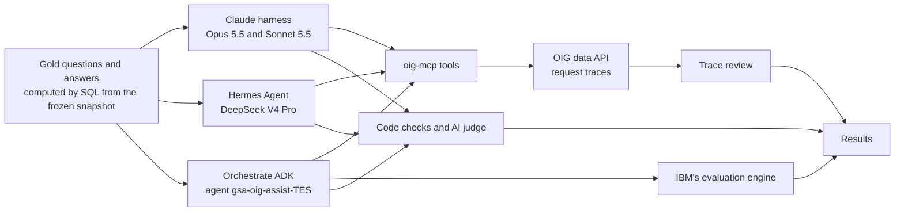

# Testing architecture

*How oig-mcp is tested, and why it is tested this way. Results are in [testing-results.md](testing-results.md). The original evaluation write-up, with its full tables, is [evaluation.md](evaluation.md).*

## What the testing is for

An MCP server is not good because it has many tools. It is good if an AI agent that knows nothing else can use those tools to answer realistic questions correctly, cite its sources, and stay within what the data supports. IBM's evaluation guide for this hackathon puts the same idea first: the quality of a server is measured by how well its tool names, descriptions, inputs, and results let a model with no other context do real work.

Everything in this document serves that goal. The automated tests and deployment checks make sure the server behaves as designed. The agent evaluation asks whether that design actually works for a model, and the cross-platform runs ask whether it works for models and hosts the builder did not tune it on.

## The layers

| Layer | What it checks | How often | Where |
|---|---|---|---|
| Automated tests | 197 tests: every tool's inputs, results, and output schema; error messages and hints; authentication; that each tool description says what a model needs to choose it | Every change, in GitHub Actions | [`tests/`](../tests/) |
| Image checks | 15 checks on the container image IBM runs: no secret inside it, a non-root user, refusal to start without a valid token or with a plain-HTTP data address, clean refusals when the data API credentials are wrong | Before each deployment | [`deploy/verify_image.sh`](../deploy/verify_image.sh) |
| Deployment checks | 22 checks on a running server: seven kinds of bad credentials refused and the right token accepted, no session state, all seven tools listed, live data returned with no secret in it, and the data API refusing four kinds of wrong credentials | Against every deployment | [`deploy/verify_deployment.py`](../deploy/verify_deployment.py) |
| Agent evaluation | 24 gold questions answered by an agent using only the tools, scored by code and an AI judge | After changes that affect what a model sees | [`eval/`](../eval/README.md) |
| Cross-platform runs | The same questions on other models and hosts | Once per platform, three runs on Orchestrate | [`eval/orchestrate/`](../eval/orchestrate/README.md) |

The first three layers test the server as software. The last two test it as something a model has to use, which is the part most servers never measure.

## The evaluation harness

The harness follows the `mcp-eval` skill that came with the hackathon template, and IBM's later `mcp-eval-wxai` version of it describes the same design with watsonx.ai models. Both build an agent that has only the server's tools, give it questions with known answers, score the answers with judges, and record every run in Arize Phoenix.

| IBM's skill | This project |
|---|---|
| A dataset of questions with verified answers | [`eval/gold/questions.json`](../eval/gold/questions.json): 24 questions. Every answer is computed by SQL in [`build_gold.py`](../eval/gold/build_gold.py) from the frozen data snapshot of November 4, 2026, opened read-only and checked against a pinned checksum, so answers do not come from the API being tested |
| An agent with no context but the tools | [`agent.py`](../eval/phoenix/agent.py): the agent's only instructions are the server's own `instructions` field, as any MCP host would receive. It connects over authenticated HTTP, so every question also passes through the server's token check |
| A correctness judge that compares answers to ground truth | [`scoring.py`](../eval/phoenix/scoring.py): code checks every fact, list, tool choice, and cited report number against the snapshot, and an AI judge decides only what code cannot, such as agreement with the reference and whether caveats were kept |
| A scope judge for in-scope answers and refusals | Five behavior questions: an ambiguous facility, a question the data cannot answer, a request for a deadline miss rate, a request to rank facilities, and a request to predict findings. Each has written criteria the judge applies |
| Phoenix traces of every run | Phoenix records each question's tool calls and answer, and each run's records and summary are kept in [`eval/results/`](../eval/results/) |
| Scripts to run an experiment | [`run_experiment.py`](../eval/phoenix/run_experiment.py) runs the set and refuses to start if the server's data does not match the pinned snapshot. [`score_external.py`](../eval/phoenix/score_external.py) scores answers collected from an agent outside the harness with the same gold and judge |

The one real difference from IBM's version is where the models run. This harness drives Claude models through Anthropic's API, where IBM's version uses watsonx.ai. The Orchestrate runs described below cover that gap: they put the same questions to IBM's own agent and model, scored by IBM's own evaluation engine.

## One question set, three platforms

The same 24 questions run on three platforms. Each tests something the others cannot.

**Claude, through the harness.** Claude Opus 5.5 and Claude Sonnet 5.5 answer all 24, with Claude Opus 5.5 as the judge. This is the controlled run: same questions, same scoring, repeatable on demand.

**DeepSeek, through Hermes Agent.** An independent agent host, Hermes Agent running DeepSeek V4 Pro 0813, answered 18 of the questions over public HTTPS. Its answers were collected and scored afterward with `score_external.py`. This tests the server with a host and a model family the builder did not use while developing it.

**IBM's agent, through watsonx Orchestrate.** The server is registered in Orchestrate as a local toolkit: Orchestrate runs the server itself over stdio and passes it the data API's address and credentials from a key_value connection. The agent `gsa-oig-assist-TES` uses its seven tools with one instruction, to answer only from what the tools return, and no other guidance, so its behavior still comes from the server. IBM's Agent Development Kit runs the 24 questions against that agent with `orchestrate evaluations evaluate`, using test files generated from the same gold set ([`eval/orchestrate/tests/`](../eval/orchestrate/tests/)). A model reached through Orchestrate's model gateway, `gpt-oss-120b`, plays the user if the agent asks a follow-up question and judges the answers.

## Three readings of each Orchestrate run

A single judge can be wrong in either direction. Each Orchestrate run is therefore read three ways.

1. **IBM's evaluation engine.** It reports whether the agent called the expected tool with the right critical argument (journey success, tool call precision and recall), whether the answer matches the gold summary and contains its key values (text match and keywords), and a verdict with reasoning for each behavior check written into the test.
2. **The project's own scoring.** The agent's answers are scored again with `score_external.py`, using the same gold answers, code checks, and judge as the Claude runs, so the platforms compare on equal terms.
3. **The data API's traces.** Every tool call carries an `X-Trace-Id` header, with `X-OIG-Client` and `X-OIG-Tool` naming the caller and the tool, and the data API records each request it receives with its parameters and response. This shows which tools the agent actually called, with what arguments, and what came back, independent of any judge.

Where the two judges agree and the traces support them, the result stands. Where they disagree, the answer is read against the gold answer and the traces, and the report says which judge was right and why. The share of questions on which the judges agree is reported with the scores.

## Repeatability

**The data is frozen.** Every run uses the snapshot of November 4, 2026. The Claude harness checks the server's data date and counts before it starts and stops if they differ, because the gold answers would no longer apply.

**Each Orchestrate question runs three times.** Models do not answer the same way every time. In one test, the agent answered the same question correctly by two different tool paths ten minutes apart. Three runs separate a question that fails consistently from a bad draw.

**The agent's settings are recorded and held fixed.** For the Orchestrate runs the agent has the seven tools, the single grounding instruction quoted above, and no guidelines, and nothing about it changes during a run.

**Tool calls are matched on what matters.** Each Orchestrate test compares only the argument on the question's critical path: strictly for identifiers and fixed values, such as a report number or the open status filter, and loosely for names and free text, which an agent can word differently and still be right. Other arguments, such as page size, are not compared.

## Limits

**One builder wrote the questions and the server.** The questions were written knowing what the server does well, and some server changes followed failures on these same questions, so later runs are not blind tests of those points.

**24 questions are a check, not a statistical estimate.** The set covers counts, closure measures, one facility, one report, recurring findings, search, inspection preparation, and five behaviors, but one or two questions per kind.

**Judges are models.** The Claude runs used a judge from the same model family as the agent. An answer can pass and still contain a small error, and one such case is described in the results.

**Some Orchestrate tests check only the answer.** Twelve gold questions accept either of two tools, or need no tool at all, and an Orchestrate test can name only one expected path. For those, the tool path is not scored by IBM's engine, and the traces show what was called instead.

**Not tested:** sustained load, and questions about report text that the tools do not return.

## How to run it

The Claude harness: [`eval/README.md`](../eval/README.md). The Orchestrate tests: [`eval/orchestrate/README.md`](../eval/orchestrate/README.md). The deployment checks: [`deploy/README.md`](../deploy/README.md).
