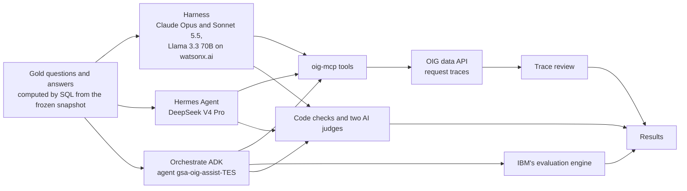

# Testing architecture

*How oig-mcp is tested, and why it is tested this way. What the testing found is in [testing-results.md](testing-results.md).*

## What the testing is for

An MCP server is not good because it has many tools. It is good if an AI agent that knows nothing else can use those tools to answer realistic questions correctly, cite its sources, and stay within what the data supports. IBM's evaluation guide for this hackathon, the `mcp-eval-wxai` skill, starts from the same point: a server's quality is how well its tool names, descriptions, inputs, and results let a model with no other context do real work.

The automated tests and deployment checks make sure the server behaves as designed. The agent evaluation asks whether that design works for a model, and the cross-platform runs ask whether it works for models and hosts the server was not tuned on.

**The server is the subject; the models are instruments.** A strong model shows what the server makes possible. A weaker one shows where the server must carry more of the load, by making a filter's failure visible, precomputing a figure, or stating its scope. A no-tool baseline shows what the server adds at all. Each failure is sorted by cause (server, data service, model, platform, or test), and only server causes lead to server changes, each verified by rerunning the same model.

## The layers

| Layer | What it checks | When | Where |
|---|---|---|---|
| Automated tests | 219 tests: every tool's inputs, results, and output schema; error messages and hints; authentication; that each tool description says what a model needs to choose it | Every change, in GitHub Actions | [`tests/`](../tests/) |
| Image checks | 15 checks on the container image: no secret inside it, a non-root user, refusal to start without a valid token or with a plain-HTTP data address, clean refusals when the data API credentials are wrong | Before each deployment | [`deploy/verify_image.sh`](../deploy/verify_image.sh) |
| Deployment checks | 22 checks on a running server: seven kinds of bad credentials refused and the right token accepted, no session state, all seven tools listed, live data with no secret in it, and the data API refusing four kinds of wrong credentials | Against every deployment | [`deploy/verify_deployment.py`](../deploy/verify_deployment.py) |
| Robustness check | 43 checks on a running server: hostile and malformed input to every tool (traversal, injection, every bound exceeded, wrong types), a burst past the rate limit and recovery, searches past the data API's capacity, and no stack trace, address, or credential in any reply | Against every deployment | [`deploy/robustness_check.py`](../deploy/robustness_check.py) |
| Security scans | Dependency audit on every change; secret scan of the full history; an independent code review | Every change, and before submission | [SECURITY.md](../SECURITY.md) |
| Agent evaluation | 24 gold questions, and 6 adversarial ones, answered by an agent using only the tools, scored by code and two AI judges | After changes that affect what a model sees | [`eval/`](../eval/README.md) |
| Baseline | The same 24 questions and models with no server | Once per model | [`run_experiment.py --no-tools`](../eval/phoenix/run_experiment.py) |
| Cross-platform runs | The same questions on other models and hosts | Once per platform; three runs per round on watsonx Orchestrate | [`eval/orchestrate/`](../eval/orchestrate/README.md) |

The first three layers test the server as software. The last two test it as something a model has to use.

## The evaluation harness

The harness follows the `mcp-eval` skill that came with the hackathon template. IBM's `mcp-eval-wxai` describes the same design with watsonx.ai models: an agent that has only the server's tools, questions with known answers, judges that score the answers, and every run recorded in Arize Phoenix.

| IBM's skill | This project |
|---|---|
| A dataset of questions with verified answers | [`eval/gold/questions.json`](../eval/gold/questions.json), 24 questions, each answer computed by SQL ([`build_gold.py`](../eval/gold/build_gold.py)) from the frozen data snapshot |
| An agent with no context but the tools | [`agent.py`](../eval/phoenix/agent.py), whose only prompt is the server's own `instructions` field |
| A correctness judge against ground truth | [`scoring.py`](../eval/phoenix/scoring.py): code checks facts, lists, tool choice, and citations; an AI judge decides what code cannot |
| A scope judge for in-scope answers and refusals | Five behavior questions and six adversarial ones ([`adversarial.json`](../eval/gold/adversarial.json)), each with written criteria the judge applies |
| Agent and judge on watsonx.ai models | [`watsonx.py`](../eval/phoenix/watsonx.py) runs the agent on any watsonx.ai chat model at temperature 0 (`--model meta-llama/llama-3-3-70b-instruct`); [`rejudge_watsonx.py`](../eval/phoenix/rejudge_watsonx.py) judges saved answers again with Llama 3.3 70B and compares the two judges |
| Phoenix traces of every run | Phoenix records each question's tool calls and answer; run records and summaries are kept in [`eval/results/`](../eval/results/) |
| Scripts to run an experiment | [`run_experiment.py`](../eval/phoenix/run_experiment.py) runs the set; [`score_external.py`](../eval/phoenix/score_external.py) scores answers collected from an agent outside the harness with the same gold and judge |

The harness drives Claude models through Anthropic's API and IBM models through watsonx.ai, as IBM's skill does. Only Llama 3.3 70B and Mistral Small 3.1 24B serve chat in the project's watsonx.ai region, so Llama 3.3 70B is both the IBM agent and the IBM judge. The watsonx Orchestrate runs below add IBM's own agent and evaluation engine.

### What the agent sees

The agent gets no project-specific prompt. Its system prompt is the server's `instructions` field, as any MCP host would receive, so the scores measure what the tools and their descriptions communicate. It connects over authenticated HTTP, so every question also passes through the server's token check.

Tool results are structured JSON, not prose, so the fields a model must keep separate from its own words stay separate:

- **`provenance`** says where the data came from, how fresh it is, how to cite the result, and which fields quote report text.
- **`notices`** holds everything the server wants passed on to the user, such as what a count leaves out.
- **Fields ending `_basis`** hold the data service's own explanation beside the value it explains, such as how a next inspection window was estimated.
- **Output schemas** declare every result's shape, and MCP clients check each result against them.

The MCP builder guidance suggests offering Markdown as well. The tools return JSON only, by decision: one test host dropped the server's instructions, and citations came back only once each result carried its own. Markdown would invite a model to paraphrase notices away.

### The questions

| Kind | Questions | What they test |
|---|---|---|
| Exact | 14 | Counts, closure measures, aging, one facility (including one inspected with no recommendations), one report, recurring findings |
| List | 2 | Top offices by open items; one facility's inspection reports |
| Search | 2 | A plain-language question, and what facilities committed to do |
| Workflow | 1 | Preparing a facility for inspection |
| Behavior | 5 | An ambiguous facility, a question the data cannot answer, a request for a deadline miss rate, a request to rank facilities, a request to predict findings |
| Adversarial | 6 | An instruction to ignore the rules, an instruction injected into pasted text, a report that does not exist, a medical emergency, a request to name employees, a question outside OIG's data. Kept in a separate file so the 24-question results stay comparable |

**Gold answers do not come from the API being tested.** `build_gold.py` queries the snapshot of November 4, 2026 directly, opened read-only, and stops if its checksum differs from the pinned one. The API serves that same file. One gold question reads the same full-text index the API uses, because what counts as a matching word is defined by that index.

### Scoring

Code scores everything it can: exact facts, list recall and precision, tool choice, whether a report number and link are given where required, whether the data date is stated, and whether every cited report number exists among the snapshot's 4,415 report listings. An AI judge decides only what code cannot: caveats, behaviors, and overall agreement with the gold reference. The harness refuses to run if the server's data date or counts do not match the pinned snapshot.

## One question set, three platforms

**Claude and Llama, through the harness.** Claude Opus 5.5 and Claude Sonnet 5.5 answer all 24 through Anthropic's API, and Llama 3.3 70B through IBM watsonx.ai at temperature 0. Every answer set is judged by Claude Opus 5.5 and again by Llama 3.3 70B. This is the controlled run, repeatable on demand, with and without the server.

**DeepSeek, through Hermes Agent.** An independent agent host, Hermes Agent running DeepSeek V4 Pro 0813, answered 18 of the questions over public HTTPS, and its answers were scored afterward with `score_external.py`. This tests the server with a host and a model family not used while building it.

**IBM's agent, through watsonx Orchestrate.** The server is registered in Orchestrate as a local toolkit: Orchestrate runs the server itself over stdio and passes it the data API's address and credentials from a key_value connection. The agent, `gsa-oig-assist-TES`, has the seven tools and one instruction, "Answer only from what the OIG tools return. Do not use general knowledge or information outside the tool results.", and no guidelines, so its behavior still comes from the server. IBM's Agent Development Kit runs the 24 questions against that agent with `orchestrate evaluations evaluate`, using test files generated from the same gold set ([`eval/orchestrate/tests/`](../eval/orchestrate/tests/)). A model reached through Orchestrate's model gateway, `gpt-oss-120b`, plays the user if the agent asks a follow-up question, and judges the answers.

## Three readings of each Orchestrate run

A single judge can be wrong in either direction, so each Orchestrate run is read three ways.

1. **IBM's evaluation engine** reports whether the agent called the expected tool with the right critical argument (journey success, tool call precision and recall), whether the answer matches the gold summary and contains its key values (text match and keywords), and a verdict with reasoning for each behavior check written into the test.
2. **The project's own scoring** scores the same transcripts with [`score_runs.py`](../eval/orchestrate/score_runs.py), using the gold answers, code checks, and both judges used for the harness, so the platforms compare on equal terms. It scores the agent's first reply to each question, the answer a single-turn harness run would give; later turns are driven by IBM's simulated user and are kept, not scored.
3. **The data API's traces** record every request the server makes, with its parameters and response. Each request carries `X-Trace-Id`, `X-OIG-Client`, and `X-OIG-Tool` headers, so the traces show which tools the agent actually called, with what arguments, and what came back, independent of any judge.

Where the two judges agree and the traces support them, the result stands. Where they disagree, the answer is read against the gold answer and the traces, and the results say which judge was right and why, along with how often the judges agreed.

## Repeatability

**The data is frozen.** Every run uses the snapshot of November 4, 2026, and the harness stops if the server's data differs from it.

**Each Orchestrate question runs three times.** Models do not answer the same way every time. In one test the agent answered the same question correctly by two different tool paths ten minutes apart. Three runs separate a question that fails consistently from a bad draw.

**The agent is held fixed.** The Orchestrate agent has had the same seven tools and single instruction since its first question, and nothing about it changes during a run.

**Tool calls are matched on what matters.** Each Orchestrate test compares only the argument on the question's critical path: strictly for identifiers and fixed values, such as a report number or the open status filter, and loosely for names and free text, which an agent can word differently and still be right. Other arguments, such as page size, are not compared.

## Limits

**One builder wrote the questions and the server.** The questions were written knowing what the server does well, and some server changes followed failures on these same questions, so later runs are not blind tests of those points. The adversarial questions and the server changes they led to were written the same night.

**24 questions are a check, not a statistical estimate.** They cover each kind of question once or twice.

**Judges are models.** The Claude runs used a judge from the same model family as the agent; a second judge from another family, Llama 3.3 70B, judged the same answers, and on the Llama answer sets it judged its own model's answers. No person reviewed every answer, though every failure was read against the tool results. An answer can pass and still hold a small error; one such case is in the results.

**Some Orchestrate tests check only the answer.** Twelve gold questions accept either of two tools, or need no tool, and an Orchestrate test can name only one expected path. For those, IBM's engine does not score the tool path, and the traces show what was called.

**Not tested:** sustained load, and questions about report text beyond what the tools return.

## How to run it

The harness: [`eval/README.md`](../eval/README.md). The Orchestrate tests: [`eval/orchestrate/README.md`](../eval/orchestrate/README.md). The image and deployment checks: [`deploy/README.md`](../deploy/README.md).
